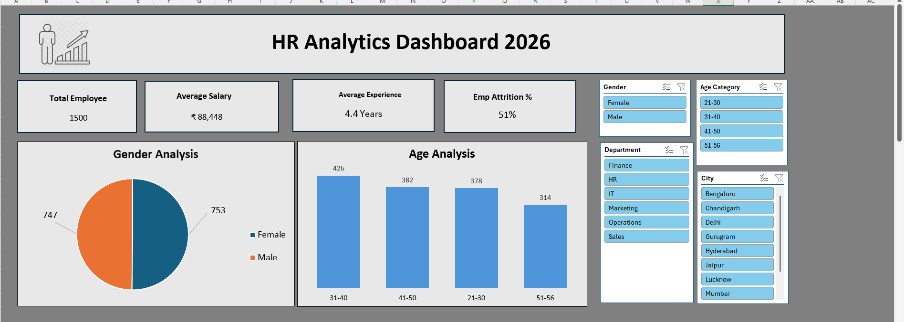
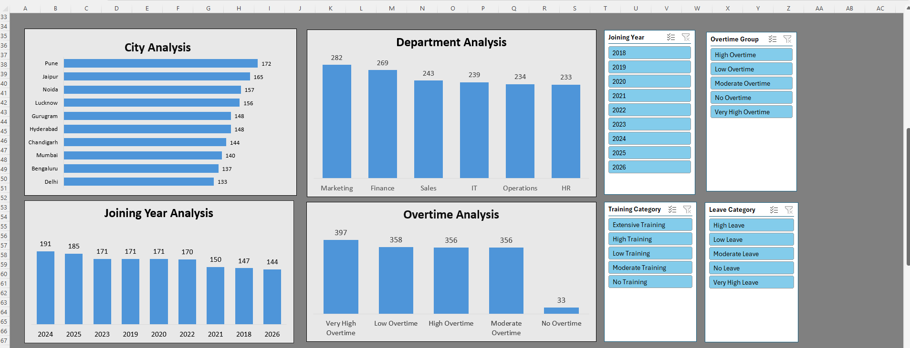
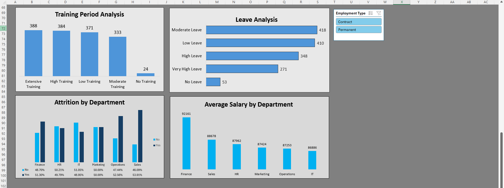
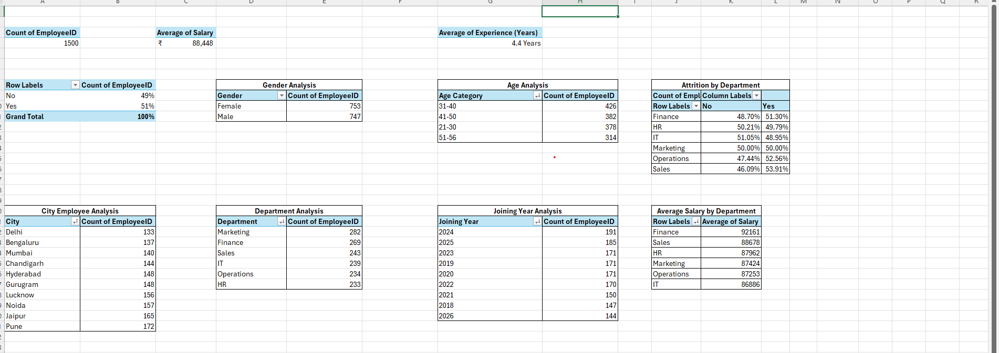

# HR Analytics Dashboard (Excel)

Interactive Excel dashboard on a 1,500-employee HR practice dataset, covering headcount, attrition, salary, overtime, leave, and training.

## Dashboard

## What I did
- Combined the Employee, Department, and City master sheets using XLOOKUP (Department Head, Budget, Region)
- Created age, overtime, training, and leave categories with nested IF formulas, and joining year with TEXT formulas
- Built 14 pivot tables and 10 charts, connected to 9 slicers (Gender, Age, Department, City, Joining Year, Overtime, Training, Leave, Employment Type)
- Added a Data Check column that flags 89 records where experience exceeds age minus 18

## Key findings
- Attrition is about 51% overall (766 of 1,500 employees) and similar across departments (49% to 54%), highest in Sales at 53.9%
- Average salary is Rs 88,448, highest in Finance at Rs 92,161
- Average experience is 4.4 years

## Pivot analysis

## Files
- [Analysis file (data, master sheets, pivot analysis, dashboard)](https://docs.google.com/spreadsheets/d/1KLakQR6yE_UVGfMeqq9jDfJx3aB8fjMp/edit?usp=sharing)
- [Raw data](https://docs.google.com/spreadsheets/d/1K8aWiN6PqivI-DGvAPeITDAZmopdZ7gc/edit?usp=sharing)

Both files are view-only. To see the slicers and charts, download the analysis file (File > Download > Microsoft Excel) and open it in Excel. This is a practice dataset, so the numbers are illustrative.

## Tools
Advanced Excel, XLOOKUP, Pivot Tables, Slicers, Nested IF, TEXT
